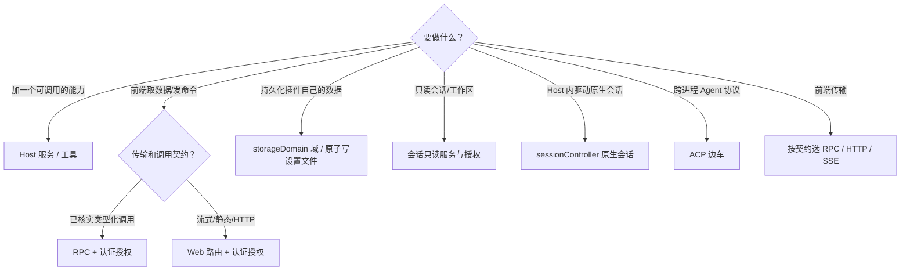

# DSH 插件后端（Host / Cordis / 服务 / RPC / 存储）

> 前端怎么落座看 `dsh-ui-extension`；这里只管“数据从哪来、怎么存、怎么被安全调用”。
> 事实来源：运行中宿主 `host/Service` inspect（105 个服务）+ DSH 0.2.1-rc.2 源码 + 两个已发布插件。

---

## 0. 先判断你要哪一种



### 五条铁律

1. **不在模块顶层做 IO**：文件、数据库、spawn 全放进 `apply` 或 `ctx.effect` 的回调里。
2. **每个注册都有 disposer**：`ctx.effect(() => dispose, 'label')`；卸载后不留路由/定时器/子进程。
3. **可选服务一律 `ctx.get()` + 降级**，缺依赖直接抛错会让整个 fiber FAILED。
4. **认证、Peer/操作授权、业务资源归属分别检查**；RPC、loopback、自定义头均不能独自替代授权。
5. **未在真机验证不写完成**；`dsh --version` 写进交付说明。

---

## 1. 组合模型：profile → bundle → patch → fiber

```text
$DSH_HOME/profiles/<name>/
  package.json        dsh.profile.bundles = [@deepseek-ai/dsh-base, 你的包, …]
  cordis.patch.yml    你这个 profile 自己的覆盖层
        ↓ 依次叠加
  各 bundle 的 dsh.bundle.patch（按 bundles 顺序）
  profile 的 cordis.patch.yml
  $DSH_HOME/cordis.patch.yml（机器级）
  --patch <file>（命令行，按 argv 顺序）
        ↓
  每一行 = 一个 Loader entry = 一个 Cordis fiber（apply/inject/effect 的宿主）
```

**层序即优先级**：后面的层按 `id` 覆盖前面的行，且**整块替换 `config`**（不是深合并）。所以覆盖别人的行要把所有键重述。

---

## 2. 最小 Host 插件

```js
export const name = 'my-plugin'
export const inject = ['webServer', 'connection']

export function apply(ctx) {
  const dispose = ctx.webServer.register({
    kind: 'exact',
    path: '/api/my-plugin/health',
    handler(request, response) {
      const rejection = ctx.connection.requestRejection(request)
      if (rejection !== undefined) { response.writeHead(rejection).end(); return }
      response.writeHead(200, { 'content-type': 'application/json', 'cache-control': 'no-store' })
      response.end(JSON.stringify({ ok: true }))
    },
  })
  ctx.effect(() => dispose, 'my-plugin: health route')
}
```

`package.json` 至少要有：

```json
{
  "type": "module",
  "main": "index.js",
  "engines": { "dsh": ">=0.2.0-rc.1 <0.3.0-0" },
  "dsh": { "manifestVersion": 1, "bundle": { "patch": "./cordis.patch.yml" } }
}
```

细节：[`manifest.md`](reference/manifest.md)、[`lifecycle.md`](reference/lifecycle.md)。

---

## 3. 先选能力所在，再选传输

| 层次 | 选择 | 场景与依据 |
|---|---|---|
| 会话引擎 | 原生 `sessionController` | Host 内驱动真实会话；见 [`native-session.md`](reference/native-session.md) |
| 会话引擎 | ACP 边车 | 需要跨进程或协议互操作；见 [`acp.md`](reference/acp.md) |
| 业务能力 | Host 服务/工具 | 给其他插件或模型调用；见 [`services.md`](reference/services.md) |
| 传输 | typed RPC | 明确客户端契约、codec 与权限；见 [`typert.md`](reference/typert.md) |
| 传输 | HTTP/SSE | 浏览器响应、流式或静态资源；见 [`routes-auth.md`](reference/routes-auth.md) |

原生和 ACP 并列；RPC 与 HTTP/SSE 是另一维度，可与任一引擎配合。SDK/MCP 只在对应契约实际可用时选用。领域预设与隔离见 [`preset-isolation.md`](reference/preset-isolation.md)。

---

## 4. 标准工作流

```text
1) dsh --version；确认宿主能力：host/Service inspect
2) 定通路（typert / 路由 / 工具 / 边车）
3) 写 apply：inject + effect + disposer，全部可卸载
4) 数据：storageDomain（有 schema）或 $DSH_HOME/<plugin>/ 原子写
5) 配置：导出 Config（Schemastery）→ 自动表单；自定义页用 settings.section
6) 测试：假宿主 + 临时 HOME，禁真实模型
7) 装：dsh plugin --profile <p> add ./ → --dump-config 验证层 → 重启
8) 验：日志/接口/前端三处证据；停用后完全恢复
```

---

## 5. 服务与生命周期（最常错的两件事）

```js
export const inject = ['storageDomain', 'sessionPersistence']   // 硬依赖：缺了不启动

export function apply(ctx, config) {
  // 软依赖：取不到就降级
  const typert = ctx.get('typert')
  if (typert === undefined) ctx.logger?.warn?.('typert not available, RPC disabled')
}
```

| 规则 | 原因 |
|---|---|
| `apply` 同步、轻量 | Loader 在启动阶段等待它；重活放 effect/异步 |
| 用 `ctx.effect(fn, label)` 包住一切 | fiber 卸载时自动清理，label 出现在诊断里 |
| 服务通过 `ctx.get('key')` 取可选依赖 | 直接 `ctx.key` 在服务缺失时抛错 |
| 需要“等某服务就绪”用 `ctx.inject([...], cb)` | 不要轮询 |
| 不在顶层 `new` 客户端/读文件 | 测试无法隔离，重载会泄漏 |

---

## 6. 认证、授权和业务边界

先 inspect 当前 `connection` 契约：认证与 Host/Origin 信任检查、所需 Peer 及操作权限、参数和资源归属分别处理；选择 RPC 不能省略业务授权。仅限本机的部署可额外采用 loopback、来源和自定义头防护，但不能把这一部署假设强加给远程或自定义协议场景。见 [`routes-auth.md`](reference/routes-auth.md)。

---

## 7. 存储与设置

| 需求 | 做法 |
|---|---|
| 有结构、要校验、要迁移 | `storageDomain.open(defineDomain({name, version, tables/global}))` |
| 少量插件设置 | `$DSH_HOME/<plugin>/settings.json` + 原子写（tmp→rename，失败回滚 `.bak`） |
| 用户可调参数 | 导出 `Config`（Schemastery）→ 自动表单（默认 `auto: true`） |
| 自定义设置页 | `settings.section` 槽 + `ctx.settings.configure({auto:false})` 关掉自动页 |

见 [`storage.md`](reference/storage.md)、[`settings.md`](reference/settings.md)。

---

## 8. 会话数据：只读优先

- 读：`ctx.sessions.get(id)` → `snapshotEvents()`；没有活实例就用 `ctx.sessionPersistence.open(id, access)`。
- 写：走官方服务（`sessionController`、`workspaceRegistry`、`workspaces.archiveSession` 等），**不直接改 `session.v4.jsonl.zstd`**。
- 归档/移动这类跨工件操作，必须带版本闸门 + 备份 + 测试，否则升级即损坏。
- 见 [`session-data.md`](reference/session-data.md)。

---

## 9. 测试与发布

```sh
node --test tests/*.test.mjs        # 只允许 mock / 假宿主 / mkdtemp
dsh plugin --profile <p> add ./pkg.tgz
dsh --profile <p> --dump-config     # 确认层
```

- 禁止真实模型调用；`<PLUGIN>_HOME` 指临时目录；
- 新行为必须带测试；
- 发布前 `pnpm pack --dry-run` 确认 `files` 包含 `lib/`、`cordis.patch.yml`。

见 [`testing.md`](reference/testing.md)。

---

## 10. 冲突与验收

- 动手前扫 `reference/shared/conflict-matrix.md`（服务替换、路由重复、单提供方、静默降级）；
- 交付前过 `reference/shared/acceptance.md`（开关、恢复、日志脱敏、版本记录）。

---

## 11. 文件地图

| 文件 | 内容 |
|---|---|
| `reference/manifest.md` | `dsh.bundle`/`dsh.profile`/`engines.dsh`/层序/安装 |
| `reference/lifecycle.md` | Cordis：apply/inject/effect/Service/dispose/HMR |
| `reference/services.md` | 105 个 Host 服务选摘与精确签名 |
| `reference/routes-auth.md` | 路由、鉴权、幂等注册、SSE |
| `reference/typert.md` | 类型化 RPC：描述符、codec、注册、客户端调用 |
| `reference/storage.md` | storageDomain 域、原子写、迁移 |
| `reference/settings.md` | Config 自动表单、自定义设置页 |
| `reference/session-data.md` | 会话/工作区数据的读写边界 |
| `reference/native-session.md` | Host 原生会话驱动与流同步 |
| `reference/preset-isolation.md` | 领域预设、指令链和技能隔离 |
| `reference/testing.md` | 假宿主、临时 HOME、版本矩阵 |
| `reference/acp.md` | ACP 边车（`dsh --profile acp`） |
| `reference/compat.md` | 版本与生效矩阵 |
| `reference/shared/*` | inspect 用法、冲突矩阵、验收 |
| `assets/skeleton-host/` | 最小可装后端插件 |

---

## 12. 高频错误

| 现象 | 原因 | 改法 |
|---|---|---|
| 启动即 FAILED | `inject` 里有此环境不存在的服务 | 降到 `ctx.get()` + 降级 |
| 二次启用失败 | 路由/监听没释放 | 全部 `ctx.effect` |
| 403/404 | 路由路径重复，或 `requestRejection` 拒了 | 先查重挂载，再查 Origin/Host |
| 前端拿不到数据 | typert 没注册到正确 service/namespace | 用 `host/Service` 对签名 |
| 改了没生效 | 没有 `touch` 引入方 / 没重载 / 没 build | 按 `reference/compat.md` |
| 测试打真模型 | 没 mock | 假 agent + 临时目录 |
| 升级后数据坏了 | 私改会话工件 | 只用公开只读接口 |
| “明明实现了但不生效”，且与 OS 交互有关 | 宿主环境限制（如进程以管理员运行时 Windows 拒绝文件拖放） | 启动日志里记环境事实（`elevated` 等），先证明能力可用再排代码 |
