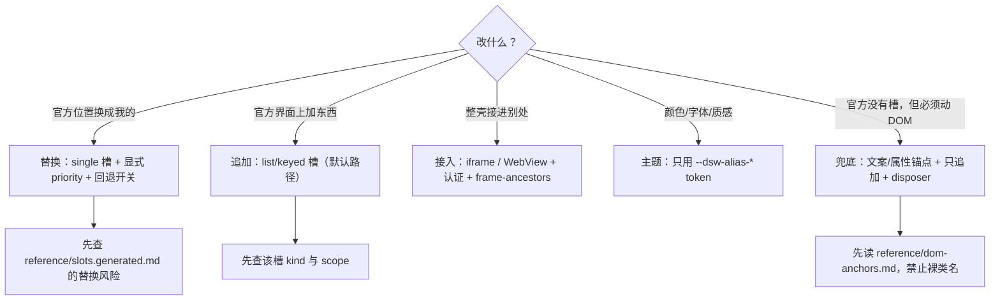
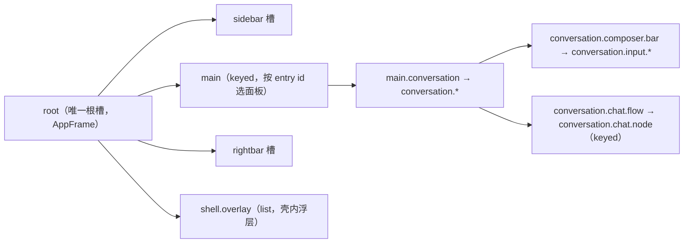

# DSH UI 扩展（通用）

> **先发现 inspect provider 并查询当前宿主，再动手。** 插槽清单随版本变，版本与采集证据见生成表及兼容记录，
> 本文件给判断方法，`reference/` 给事实，`assets/skeleton/` 给可跑的最小插件。
> 事实来源：运行中宿主 `client/Slots` inspect + 源码 + 两个已发布插件（Codex UI 2.2.2、Archive Manager 1.3.6）。

---

## 0. 30 秒判断：你要的是哪一种



### 五条铁律

1. **不改 DSH 本体**（`app.asar`、DSH 源码、`vendor/dsh`），只走插槽、样式、注入、配置。
2. **不手改构建产物**，只改源码再构建。
3. **能追加就不替换**：默认禁用替换功能，提供明确关闭替换并恢复原功能的路径，在交付说明里写明“已移除什么”。
4. **未真机验证不写完成**；证据见 `reference/shared/acceptance.md`。
5. **版本写进交付**：`dsh --version` 的输出必须出现在说明里。

---

## 1. 认知模型



| 事实 | 含义 |
|---|---|
| 五种基数 | `single` 单占 / `list` 列表 / `keyed` 键控 / `chain` 竞选 / `hoc` 包裹 |
| 三种作用域 | `root` 常驻 / `session` 必须有会话 / `session-maybe` 有就用 |
| 槽不是全局的 | 每个槽由某个 entry 通过 `children` 声明；**owner 没挂载，槽就不存在** |
| 组件拿不到 `ctx` | 依赖通过 `inject` 工厂返回；共享视图状态用 `store`；本地化用 `locale` |
| Factory ≠ 槽 | `conversation.content`、`conversation.user.text`、`conversation.approval.card` 等是组件定义，注册必失败 |

---

## 2. 三条通路（先选通路，再写代码）

| 通路 | 适用 | 代价 | 入口 |
|---|---|---|---|
| **A. 静态 client 插件** | 正式发布、要用 UI 基础组件/lucide、要 import | 需要构建成 `__ModuleLoader__` 产物 | `reference/build-client.md` |
| **B. 动态 Cordis 包** | 试用、一次性、运行时注入 | **禁止 import**，只能 `React.createElement` + `styles.insert` | `shared/inspect-usage.md` + `Builtin` provider |
| **C. DOM 兜底** | 官方没有槽、且已确认无法用 A/B | 版本脆弱，必须登记 | `reference/dom-anchors.md` |

**默认优先官方槽与主题 token，最后考虑 DOM。** 动态工具仅在当前宿主实际提供时可选，不把它当必备能力。三种工作台与 iframe 的信任边界见 [`workbench-integration.md`](reference/workbench-integration.md)。

---

## 3. 最小工作流

1. **查版本**：`dsh --version`。
2. **查槽**：`Slots.listSubTree`（或 `input:{root:"目标槽"}`）确认存在、`kind`、`scope`、occupant。
3. **选通路**：能进槽就别动 DOM。
4. **写组件**：props 从 `PropsRuntime<'槽名'>` 推导，别手抄字段。
5. **注册**：`ctx.slots.inject(key, () => ctx.slots.register(opts, Component))`，返回 disposer。
6. **构建/安装**：静态包先构建再按部署要求安装；动态机制只有当前工具实际提供时才采用。
7. **验**：见 `reference/shared/acceptance.md`（关→开→关、窄屏、暗色、重复启用）。
8. **记**：版本、改动、开关、已知限制。

---

## 4. 注册语义速查

```js
// list 槽：追加，必须 id
ctx.slots.inject('conversation.input.right', () => ctx.slots.register({
  name: 'conversation.input.right',
  id: 'my-plugin.send-with-context',
  order: 100,
  label: () => '带上下文发送',
}, MyButton))
```

| 基数 | 必填 | 可选 | 语义 |
|---|---|---|---|
| `single` | — | — | 一个格子；同 `priority` 第二次注册**抛错** |
| `list` | `id` | `order`、`label` | 按 `order` 升序并列 |
| `keyed` | `key` | — | 按 owner 的 key 表命中；抢已占 key 会冲突 |
| `chain` | `select(owner)` | `priority` | 按优先级取第一个非 null |
| `hoc` | `id` | `key`、`order` | 包裹 owner 内容，不改内容本身 |

- **`priority` 只在“明确替换”时写**，数值越小越优先；不写默认 0。list/keyed 也必须检查 id/key 占用：复用已有标识可能覆盖，不能一概视为追加。
- **替换一个已被占的单占槽**要走 `reference/elements.md` §3 的三步，不允许“注册了事”。
- 动态包的浏览器半由门面自动分配更低的 `priority`，**不要手写**。

---

## 5. 元素能力地图怎么用

`reference/elements.md` 按界面区域给出：**这个元素属于哪个宿主模块 → 有没有槽 → 是不是替换 → 推荐方案 → 风险**。
`reference/slots.by-area.md` 是同一批槽按“侧栏 / 输入区 / 消息区 / 设置 / 插件管理 / 右栏 / 外壳”的区域导航。
`reference/slots.generated.md` 是**特定版本的生成快照**，实时能力以当前 inspect 为准。

判定顺序：

```text
有槽？ ──否──> 有官方服务/事件能做吗？ ──否──> DOM 兜底（登记 + 只用锚点）
  │是
  ├─ list/keyed ──> 直接追加
  └─ single ──> 有 occupant？
                 ├─ 无 → 直接注册
                 └─ 有 → 必须替换吗？→ 否：换位置/换思路；是：显式 priority + 回退
```

---

## 6. 主题与样式

- 只用语义 token：`--dsw-alias-bg-base` / `-bg-layer-1` / `-label-primary` / `-border-l1` / `-brand-primary` / `-state-*`。
- 亮暗两套自动成立的前提是**不写颜色字面量**；必须写时按 `[data-theme]` 各给一份。
- 自己的样式一律加容器前缀（`[data-my-plugin]`），不写裸元素选择器。
- 覆盖层级：`shell.overlay` 在壳内；是否需要 portal 及具体层级应在目标宿主实测，避免遮挡官方弹窗。
- 细节见 `reference/theming.md`。

---

## 7. 冲突与兼容

动手前扫 `reference/shared/conflict-matrix.md`。最常踩的五条：

1. 单占槽同优先级注册直接抛错；
2. owner 没挂载时注册抛 “not declared”；
3. 两个 entry 声明同一子槽 → 激活失败；
4. 替换官方服务后停用插件，官方不回来；
5. 写死颜色/全局选择器，第三方 UI 被误伤。

---

## 8. 验收（缺一不可）

见 `reference/shared/acceptance.md`。最低要求：**关→开→关三次一致、窄屏与暗色都过、官方原功能可触达或已声明移除、版本已记录**。

---

## 9. 文件地图

| 文件 | 内容 |
|---|---|
| `reference/slots.generated.md` | 槽位快照（生成，含类型/作用域/替换风险/声明者） |
| `reference/workbench-integration.md` | 原生 UI、自有工作台与外部嵌入的边界 |
| `reference/slots.by-area.md` | 按界面区域导航的选槽表 |
| `reference/elements.md` | 元素能力地图：模块归属、可否替换、方案与风险 |
| `reference/dom-anchors.md` | 哈希类名安全锚点、注入范式、清理 |
| `reference/recipes.md` | 12 个配方（品牌、面板、留洞、按钮、设置页、主题…） |
| `reference/theming.md` | token 清单与用法 |
| `reference/build-client.md` | 静态 client 半构建（`__ModuleLoader__` 契约） |
| `reference/compat.md` | 版本矩阵与升级流程 |
| `reference/shared/*` | inspect 用法、冲突矩阵、验收（由 `shared/` 生成） |
| `assets/skeleton/` | 最小可装 UI 插件 |

---

## 10. 高频错误

| 现象 | 原因 | 改法 |
|---|---|---|
| `single slot ... already has a registration` | 往单占槽加东西 | 换 list 槽；确需替换走 §5 三步 |
| `slot "x" is not declared` | owner 没挂载 | 用 `ctx.slots.inject` 等声明 |
| 注册成功但不显示 | 作用域不对（`session` 槽无会话） | 换 `session-maybe`/`root` 槽 |
| 出现两份按钮 | 没清理旧节点 | 每轮先 `cleanup`，返回 disposer |
| 改了没生效 | 没 build / 没刷新 / 没重载 | 按 `reference/compat.md` 的生效矩阵 |
| 亮色模式瞎眼 | 写死颜色 | 换 token |
| 装配后官方侧栏消失 | 把官方行 disable 了 | 恢复官方行，改用增强 |
| 文件拖不进来、光标是“禁止” | 宿主窗口以管理员运行（UIPI 拦掉整窗的 OLE 拖放），或自建 iframe 带 `sandbox` | **先分层取证**：宿主页与子 frame 各挂捕获监听（无类型过滤），再查进程 `integrity` 与 `sandbox`；别先改 handler |
